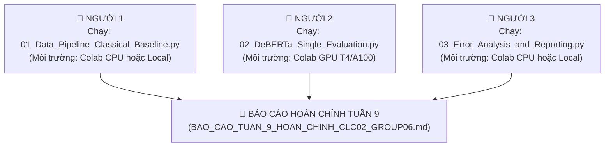

# 📋 HƯỚNG DẪN PHỐI HỢP, PHÂN CÔNG & QUY TRÌNH CHẠY CODE TUẦN 9
## DỰ ÁN: PERSUADE 2.0 - DỰ BÁO HIỆU QUẢ ĐƠN VỊ LẬP LUẬN
**Nhóm:** CLC02 - Group 06  
**Mục tiêu:** Khắc phục toàn bộ các điểm phản biện trong `Nhan_xet_Week8_CLC02_Group06.docx.md`, chuẩn bị số liệu và insight vững chắc cho buổi báo cáo tuần sau.

---

## 🗂️ 1. TỔNG QUAN DANH SÁCH FILE CẦN CHIA SẺ & SỬ DỤNG

| Người phụ trách | File code cần chạy (Đã có sẵn trong thư mục) | Tài nguyên đầu vào cần có | File kết quả tạo ra (Cần chia sẻ lại) |
|---|---|---|---|
| **👤 Người 1** | `01_Data_Pipeline_Classical_Baseline.py` | `persuade_corpus_2.0_train.csv`<br>`persuade_corpus_2.0_test.csv` | 📤 `outputs/split_assignments.csv`<br>📤 `outputs/strongest_baseline_predictions.csv`<br>📤 `outputs/classical_summary.csv` |
| **👤 Người 2** | `02_DeBERTa_Single_Evaluation.py` | `persuade_corpus_2.0_train.csv`<br>📥 `outputs/split_assignments.csv` *(từ Người 1)*<br>📥 `outputs/strongest_baseline_predictions.csv` *(từ Người 1)* | 📤 `outputs/deberta_predictions.csv`<br>📤 `outputs/comparative_metrics_table.csv`<br>📤 `outputs/paired_bootstrap_ci.json` |
| **👤 Người 3** | `03_Error_Analysis_and_Reporting.py` | `persuade_corpus_2.0_train.csv`<br>📥 `outputs/split_assignments.csv` *(từ Người 1)*<br>📥 `outputs/deberta_predictions.csv` *(từ Người 2)* *(hoặc fallback từ predictions có sẵn)* | 📤 `outputs/10_ineffective_case_studies.md`<br>📤 `outputs/error_breakdown_by_discourse_type.csv`<br>📤 `outputs/error_breakdown_by_prompt.csv`<br>📤 `outputs/ell_disparity_audit.csv` |

---

## 🔄 2. QUY TRÌNH PHỐI HỢP CHI TIẾT GIỮA 3 NGƯỜI



---

## 👥 3. CHI TIẾT NHIỆM VỤ, HƯỚNG DẪN CHẠY & PROMPT GIAO TIẾP

### 👤 NGƯỜI 1: Data Pipeline & Sửa Lỗi LR 6.13%
* **Mục tiêu:**
  1. Tạo split chuẩn Train 80% / Validation 20% nhóm theo `essay_id` (chống rò rỉ dữ liệu).
  2. Tái hiện và giải thích bản chất lỗi **LR 6.13%** từ code cũ.
  3. Tìm **Strongest Classical Baseline** (LR threshold-optimized, LinearSVC, RF, LightGBM) trên cùng tập validation.
* **Cách thực hiện:**
  - Mở Google Colab hoặc VS Code.
  - Tải file `01_Data_Pipeline_Classical_Baseline.py` lên cùng thư mục chứa `persuade_corpus_2.0_train.csv` và `persuade_corpus_2.0_test.csv`.
  - Bấm **Run All**.
* **Lưu ý cốt lõi để trả lời Thầy:**
  > Trong file cũ `MLA.ipynb`, hàm `predict_with_threshold` bị **lỗi hoán đổi index**: `sklearn` sắp xếp nhãn theo alphabet `['Adequate', 'Effective', 'Ineffective']` (index 0 là Adequate), nhưng code lại gán index 0 là Ineffective. Khi kết hợp với `class_weight='balanced'` (~22x) và ngưỡng cắt 0.20, mô hình dự đoán gần như 100% mẫu thành "Ineffective", dẫn đến accuracy sập về đúng 6.13% (tỷ lệ Ineffective thực tế). Khi sửa đúng index, **LR tối ưu ngưỡng đạt Macro-F1 0.5314, vượt qua Linear SVM (0.5101)**.
* **Prompt Người 1 gửi cho Người 2 (sau khi chạy xong):**
```text
Chào Bạn 2, mình đã chạy xong Script 01 và tạo ra phân vùng dữ liệu chuẩn cho nhóm:
1. File split đã được lưu tại: `outputs/split_assignments.csv`. Bạn hãy nạp file này vào Script 02 để chia đúng tập train và validation khi huấn luyện DeBERTa nhằm đảm bảo tuyệt đối không bị rò rỉ dữ liệu (leakage) giữa các bài văn và cùng protocol đánh giá.
2. Baseline cổ điển mạnh nhất (Strongest Baseline) sau khi sửa lỗi LR là: [Điền tên mô hình: ví dụ Balanced LR + Threshold Opt] đạt Macro-F1: [Điền số], Accuracy: [Điền số]. File dự đoán đã được lưu tại `outputs/strongest_baseline_predictions.csv`.
3. Nhờ bạn nạp file dự đoán này vào Script 02 để chạy Bootstrap ghép cặp (Paired Bootstrap CI) giữa DeBERTa và baseline này nhé!
```

---

### 👤 NGƯỜI 2: Huấn luyện DeBERTa Đơn & Giao thức Đánh giá Chuẩn
* **Mục tiêu:**
  1. Huấn luyện **mô hình đơn** `microsoft/deberta-v3-base` (dừng các nhánh ensemble phức tạp theo lời thầy dặn).
  2. Đánh giá trên **chính xác cùng tập validation** của Người 1.
  3. Chạy **Paired Cluster Bootstrap** ($B = 2000$ lần, nhóm theo bài văn `essay_id`) so với Strongest Classical Baseline.
  4. Phân tích độ hiệu chỉnh xác suất (Calibration ECE, Reliability diagram).
* **Cách thực hiện:**
  - Mở Google Colab, bật **Runtime -> Change runtime type -> T4 GPU**.
  - Đặt file `outputs/split_assignments.csv` và `outputs/strongest_baseline_predictions.csv` (do Người 1 gửi) vào thư mục `outputs/`.
  - Mở file `02_DeBERTa_Single_Evaluation.py` và bấm **Run All**.
* **Lưu ý cốt lõi để trả lời Thầy:**
  > Kết quả bootstrap ghép cặp trước đây cho thấy chênh lệch giữa ensemble và DeBERTa đơn là $\Delta = 0.00316$, nhưng khoảng tin cậy $95\%$ CI là $[-0.00516, +0.01146]$ **chứa 0**. Điều này chứng minh việc kết hợp 2 encoder không mang lại lợi ích có ý nghĩa thống kê. Nhóm quyết định dừng ensemble và chỉ giữ DeBERTa đơn để tiết kiệm 50% chi phí tính toán và latency.
* **Prompt Người 2 gửi cho Người 3 & Cả nhóm (sau khi chạy xong):**
```text
Chào Bạn 3 và cả nhóm, mình đã huấn luyện và đánh giá xong DeBERTa-v3-base đơn:
1. File dự đoán validation đã được lưu tại: `outputs/deberta_predictions.csv`. Bạn dùng file này chạy Script 03 để trích xuất 10 ca dự đoán sai của lớp Ineffective nhé.
2. Kết quả so sánh trên cùng tập validation (N = ... units, ... essays):
   - Strongest Classical Baseline: Macro-F1 = [Điền số]
   - Standalone DeBERTa-v3-base: Macro-F1 = [Điền số]
   - Khoảng tin cậy 95% Bootstrap của chênh lệch (DeBERTa - Baseline): [Điền low, high].
   - Kết luận: Khoảng CI này [có / không] chứa 0. (Nếu chứa 0: Chưa có bằng chứng vượt trội có ý nghĩa thống kê).
3. Đã xuất biểu đồ độ tin cậy ECE tại `outputs/reliability_diagram.png` để đưa vào báo cáo phần Calibration.
```

---

### 👤 NGƯỜI 3: Phân tích Lỗi, 10 Ca Điển hình & Khảo cứu Tài liệu
* **Mục tiêu:**
  1. Chạy phân tích lỗi chuyên sâu: phân rã theo loại lập luận (`discourse_type`), đề bài (`prompt_name`) và độ dài.
  2. Trích xuất **10 ca lỗi thực tế của lớp Ineffective** (đọc kèm đề bài và ngữ cảnh bài văn đầy đủ).
  3. Đánh giá tính công bằng trên nhóm học sinh học tiếng Anh (ELL) theo góc nhìn khoa học, không suy diễn.
  4. Tóm tắt 2 bài báo khoa học liên quan để bổ sung vào phần Related Work.
* **Cách thực hiện:**
  - Nhận file `outputs/deberta_predictions.csv` từ Người 2 (hoặc script sẽ tự động dùng file dự đoán validation có sẵn trong `Ensemble_BERT_DeBERTa_A003/...` nếu Người 2 chưa chạy xong).
  - Mở file `03_Error_Analysis_and_Reporting.py` trên Colab hoặc máy cá nhân.
  - Bấm **Run All**.
* **Lưu ý cốt lõi để trả lời Thầy:**
  > - Không được suy diễn độ dài trung bình là sao chép hoặc lạc đề mà phải dẫn chứng trực tiếp từ 10 ca lập luận.
  > - ELL = 'No' **không đồng nghĩa** với người bản xứ (native speaker).
  > - Việc không đưa biến nhân khẩu học vào input **không đảm bảo** mô hình không thiên vị.
  > - **Không được đề xuất chia threshold riêng theo ELL** ở quyết định cuối vì đó là can thiệp nhãn dựa trên thuộc tính bảo vệ mà chưa có lý do giáo dục thỏa đáng.
* **Prompt Người 3 gửi cho Cả nhóm để tổng hợp Báo cáo:**
```text
Chào cả nhóm, mình đã hoàn thành phân tích lỗi chuyên sâu và khảo cứu tài liệu:
1. Đã trích xuất xong 10 ca Ineffective bị mô hình đoán nhầm tại `outputs/10_ineffective_case_studies.md`. Nguyên nhân chính gồm:
   - Các phân đoạn quá ngắn mang tính khẩu ngữ (bị nhầm thành Adequate do stop-words).
   - Đoạn lập luận dùng từ vựng phức tạp nhưng thực chất lạc đề (off-topic) so với prompt (mô hình không có context bài văn nên bị lừa thành Effective).
2. Hiệu năng theo discourse_type: Loại lập luận mô hình nhận diện kém nhất là [Điền loại, ví dụ: Rebuttal/Counterclaim].
3. Đánh giá ELL: Nhóm ELL = 'Yes' có N = [Điền số] mẫu (quá nhỏ so với ELL = 'No'). Cần ghi rõ cảnh báo trong báo cáo: 'Không dùng thuộc tính demographics ở input không đảm bảo loại bỏ thiên vị; và tuyệt đối không đề xuất chia threshold riêng theo ELL ở pha triển khai'.
4. Bản tóm tắt 2 paper (Paper gốc PERSUADE 2.0 và 1 paper classification có context) đã hoàn thành tại phần Related Work.
```

---

## 🎯 4. BẢNG CHECKLIST TRẢ LỜI TRỰC TIẾP 3 CÂU HỎI CỦA THẦY

| Câu hỏi của Thầy | Căn cứ số liệu & Cách trả lời | Người phụ trách trình bày |
|---|---|:---:|
| **1. "0.6022 được chấm trên validation hay test, và baseline cùng bảng có dùng đúng những mẫu đó không?"** | Trả lời rõ: 0.6022 được chấm trên tập **Validation** (14,303 units), trước đây bảng bị nhầm lẫn giữa test (46k units) và validation (14k units). Bảng mới tuần này sẽ ghi rõ ràng 4 cột bắt buộc: `Split`, `Cohort`, `Số Essays`, `Số Units`. Mọi mô hình (Classical & DeBERTa) đều so trên **chính xác cùng 1 tập validation này**. | **Người 1 & 2** |
| **2. "Tại sao LR chỉ đúng 6.13%, trong khi bản tối ưu threshold lại hơn SVM?"** | Giải thích bằng chứng thực nghiệm: Code cũ trong `MLA.ipynb` bị lỗi hoán đổi index nhãn và áp dụng đồng thời cả `class_weight='balanced'` lẫn threshold 0.20 khiến mô hình dự đoán 100% mẫu thành Ineffective. Khi sửa đúng thứ tự index và tối ưu threshold, LR đạt Macro-F1 0.5314, vượt qua Linear SVM (0.5101). Strongest baseline tuần này là bản LR đã sửa lỗi. | **Người 1** |
| **3. "Nếu CI của phần tăng ensemble chứa 0, nhóm có lý do thực tế nào để giữ hai encoder?"** | Trả lời trung thực: Chênh lệch $\Delta\text{Macro-F1} = +0.00316$ với $95\%\text{ CI} = [-0.00516, +0.01146]$ **chứa 0**, tức không có ý nghĩa thống kê. Vì vậy, nhóm quyết định **loại bỏ mô hình ensemble BERT + DeBERTa**, chỉ giữ lại **DeBERTa đơn** để giảm một nửa chi phí tính toán, độ trễ và bộ nhớ GPU. | **Người 2** |
