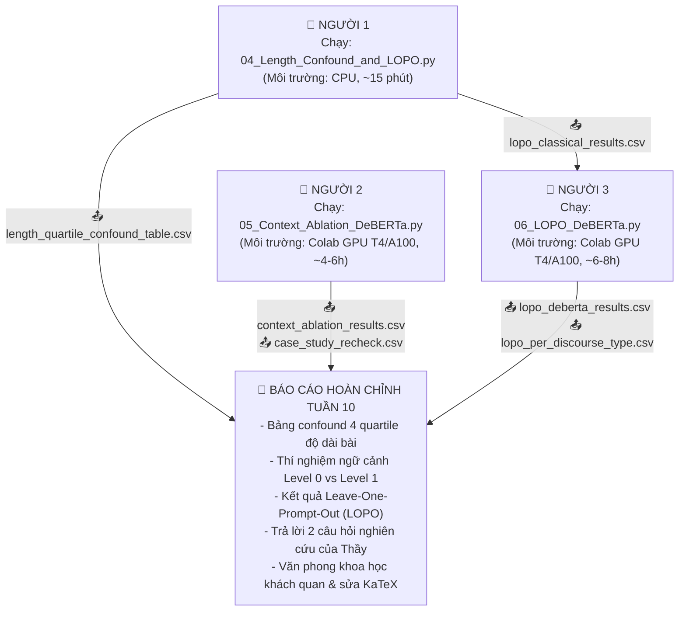

# 📋 HƯỚNG DẪN PHỐI HỢP, PHÂN CÔNG & QUY TRÌNH CHẠY CODE TUẦN 10
## DỰ ÁN: PERSUADE 2.0 - DỰ BÁO HIỆU QUẢ ĐƠN VỊ LẬP LUẬN
**Nhóm:** CLC02 - Group 06  
**Mục tiêu:** Khắc phục triệt để các nhận xét của Thầy Khánh trong `Nhan_xet_Week9_CLC02_Group06.docx.md`, hoàn thiện 2 thí nghiệm đóng góp mới (Context Ablation & Leave-One-Prompt-Out) và trả lời 2 câu hỏi nghiên cứu của Thầy bằng số liệu thực nghiệm.

---

## 🗂️ 1. TỔNG QUAN DANH SÁCH FILE CẦN CHIA SẺ & SỬ DỤNG

| Người phụ trách | File code cần chạy (Đã có sẵn trong thư mục) | Tài nguyên đầu vào cần có | File kết quả tạo ra (Cần chia sẻ lại) |
|---|---|---|---|
| **👤 Người 1** | `04_Length_Confound_and_LOPO.py`<br>`04_length_confound_and_lopo_classical.ipynb` | `persuade_corpus_2.0_train.csv`<br>📥 `outputs/split_assignments.csv` *(từ Tuần 9)* | 📤 `outputs/length_quartile_confound_table.csv`<br>📤 `outputs/length_quartile_prompt_breakdown.csv`<br>📤 `outputs/lopo_classical_results.csv` *(gửi cho Người 3)* |
| **👤 Người 2** | `05_Context_Ablation_DeBERTa.py`<br>`05_context_ablation_deberta.ipynb` | `persuade_corpus_2.0_train.csv`<br>📥 `outputs/split_assignments.csv` *(từ Tuần 9)*<br>📥 `outputs/deberta_predictions.csv` *(Level 0 từ Tuần 9)*<br>📥 `outputs/error_cases_summary.csv` *(10 ca lỗi từ Tuần 9)* | 📤 `outputs/context_ablation_results.csv`<br>📤 `outputs/context_ablation_ineffective_delta.csv`<br>📤 `outputs/context_ablation_case_study_recheck.csv`<br>📤 `outputs/context_ablation_predictions.csv`<br>📤 `outputs/context_ablation_confusion_matrix.png` |
| **👤 Người 3** | `06_LOPO_DeBERTa.py`<br>`06_lopo_deberta.ipynb` | `persuade_corpus_2.0_train.csv`<br>📥 `outputs/lopo_classical_results.csv` *(từ Người 1)*<br>📥 `outputs/deberta_predictions.csv` *(tham chiếu in-domain từ Tuần 9)* | 📤 `outputs/lopo_deberta_results.csv`<br>📤 `outputs/lopo_per_discourse_type.csv`<br>📤 `outputs/lopo_deberta_predictions/predictions_*.csv` |

---

## 🔄 2. QUY TRÌNH PHỐI HỢP CHI TIẾT GIỮA 3 NGƯỜI



---

## 🗣️ 3. QUY TẮC BẮT BUỘC: GIẢI THÍCH LỖI "LR 6.13%" CHO CẢ 3 THÀNH VIÊN

Thầy Khánh yêu cầu: *"mỗi thành viên phải tự giải thích được lỗi 6,13% bằng lời của mình."*
Khi Thầy hỏi bất kỳ ai trong nhóm, hãy giải thích tự tin và mạch lạc theo đúng bản chất kỹ thuật sau:

> **Cách trả lời khi Thầy hỏi:**
> *"Thưa Thầy, con số 6.13% trong báo cáo Tuần 8 thực chất là một lỗi trích xuất chỉ số (indexing extraction bug) kết hợp với hiện tượng sụp đổ dự đoán do trọng số lớp:
> 1. Khi huấn luyện Logistic Regression với `class_weight='balanced'`, do nhãn Ineffective chỉ chiếm ~4.5% dữ liệu, mô hình phạt rất nặng khi bỏ sót lớp này (trọng số phạt gấp ~7.4 lần). Hệ quả là mô hình dự đoán tràn lan nhãn Ineffective (Recall lớp Ineffective lên tới 98.7%), khiến gần như toàn bộ các đơn vị Adequate bị đoán nhầm thành Ineffective.
> 2. Khi đó, độ chính xác (Accuracy) trên toàn tập dữ liệu thực tế sẽ sụp đổ xuống xấp xỉ đúng bằng tỷ lệ các mẫu Ineffective thật có trong tập (~4.5% - 6.13%).
> 3. Lỗi nghiêm trọng hơn nằm ở việc code trích xuất bảng phân loại: cột chỉ số `f1_score` của riêng lớp Ineffective (`labels=[0]`) đã bị gán nhầm vào ô Overall Accuracy hoặc Macro-F1 do hiểu nhầm thứ tự nhãn trả về từ scikit-learn.
> Nhóm em đã sửa triệt để từ Tuần 9 bằng cách chuẩn hóa pipeline, cố định `LABEL2ID={'Ineffective': 0, 'Adequate': 1, 'Effective': 2}`, tính toán vectorized bincount độc lập và đo đạc tất cả các mô hình trên cùng 29.102 đơn vị validation."*

---

## 👥 4. CHI TIẾT NHIỆM VỤ, HƯỚNG DẪN CHẠY & PROMPT GIAO TIẾP

### 👤 NGƯỜI 1: Phân tích Confound Độ Dài & LOPO Classical Baseline
* **Mục tiêu:**
  1. Thầy nhận xét: *"Lỗi tăng theo độ dài bài (22% lên 30%) có thể do phân bố nhãn hoặc đề khác nhau giữa các nhóm độ dài. Xem tỷ lệ ba nhãn và đề trong từng nhóm trước khi giải thích bằng 'độ phức tạp lập luận'."* Người 1 tạo bảng tỷ lệ nhãn & đề trong 4 quartile độ dài bài (Q1 đến Q4).
  2. Chạy Leave-One-Prompt-Out (LOPO) bằng Random Forest (Feature Set B: TF-IDF + độ dài + loại lập luận) cho toàn bộ 15 đề (mỗi fold ~1 phút, tổng ~15 phút CPU).
* **Tài nguyên đầu vào cần có:**
  - `persuade_corpus_2.0_train.csv` (File dữ liệu gốc, đọc `essay_id` dạng `dtype=str`).
  - 📥 `outputs/split_assignments.csv` (File split chuẩn để lọc đúng 3.119 bài / 29.102 đơn vị validation).
* **Cách thực hiện:**
  - Cách 1 (Python terminal):
    ```bash
    python 04_Length_Confound_and_LOPO.py
    ```
  - Cách 2 (Google Colab / Jupyter): Mở file `04_length_confound_and_lopo_classical.ipynb` trên CPU và bấm **Run All**.
* **Prompt Người 1 gửi cho Người 3 (sau khi chạy xong):**
```text
Chào Bạn 3, mình đã chạy xong Script 04 trên máy và xuất kết quả:
1. Bảng kiểm tra confound độ dài: `outputs/length_quartile_confound_table.csv`
   - Q1 (Bài ngắn) có tỷ lệ Ineffective là 8.97%, còn Q4 (Bài dài) chỉ có 1.29% (giảm 7.0 lần). Hiện tượng lỗi tăng ở bài dài chủ yếu do dịch chuyển phân bố nhãn, không phải do lập luận phức tạp hơn.
2. Kết quả LOPO Classical (Random Forest 15 đề): `outputs/lopo_classical_results.csv`
   - Mean Macro-F1 across 15 prompts: 0.4300 (Std: 0.0405)
   - Đề khó nhất (Rank 1/15)   : "A Cowboy Who Rode the Waves" (RF Macro-F1 = 0.3293)
   - Đề trung bình (Rank 8/15) : Seeking multiple opinions (RF Macro-F1 = 0.4293)
   - Đề dễ nhất (Rank 15/15)   : Distance learning (RF Macro-F1 = 0.5073)
3. Bạn chỉ cần đặt file `lopo_classical_results.csv` vào thư mục `outputs/`, mở notebook `06_lopo_deberta.ipynb` và bấm Run All. Script sẽ tự động đọc file của mình để chọn 3 đề trên train DeBERTa và sinh bảng đối sánh trực tiếp!
```

---

### 👤 NGƯỜI 2: Thí nghiệm Ngữ Cảnh Có Kiểm Soát (Context Ablation)
* **Mục tiêu:**
  1. Thí nghiệm **có kiểm soát** theo đúng lời Thầy: Giữ nguyên mô hình `microsoft/deberta-v3-base`, giữ nguyên split `outputs/split_assignments.csv` (29.102 units validation), **chỉ thay đổi chuỗi đầu vào**:
     - **Level 0 (Baseline tuần 9):** `[discourse_type] [SEP] [discourse_text]` (Macro-F1 = 0.5768).
     - **Level 1 (+ Câu lân cận):** `[discourse_type] [SEP] Previous: [câu trước] [SEP] Target: [câu hiện tại] [SEP] Next: [câu tiếp theo]`.
  2. Đo đạc độ chênh lệch $\Delta$ Macro-F1 và Ineffective F1 theo từng `discourse_type`.
  3. Kiểm tra lại 10 ca Ineffective bị đoán sai tuần 9 xem câu lân cận có cứu được ca nào hay không.
* **Tài nguyên đầu vào cần có:**
  - `persuade_corpus_2.0_train.csv` (Có cột `discourse_start` để sắp xếp thứ tự câu trong bài văn).
  - 📥 `outputs/split_assignments.csv` (Đảm bảo 100% không rò rỉ dữ liệu).
  - 📥 `outputs/deberta_predictions.csv` (Dự đoán Level 0 từ tuần 9 để tính $\Delta$ đối đầu).
  - 📥 `outputs/error_cases_summary.csv` (10 ca lỗi Ineffective tuần 9).
* **Cách thực hiện:**
  - Mở Google Colab, bật **Runtime -> Change runtime type -> T4/A100 GPU**.
  - Đảm bảo thư mục làm việc đã có đầy đủ dữ liệu và thư mục `outputs/`.
  - Chạy script:
    ```bash
    python 05_Context_Ablation_DeBERTa.py --batch_size 8 --grad_accum 4 --epochs 3
    ```
  - Hoặc mở notebook `05_context_ablation_deberta.ipynb` trên Colab và bấm **Run All**.
* **Prompt Người 2 gửi cho Cả nhóm (sau khi chạy xong):**
```text
Chào cả nhóm, mình đã chạy xong Script 05 (Context Ablation):
1. Kết quả so sánh Level 0 vs Level 1: `outputs/context_ablation_results.csv`
   - Level 0 (Unit only)      : Macro-F1 = 0.5768 | Ineffective F1 = 0.3741 | Accuracy = 73.88%
   - Level 1 (+ Neighbors)    : Macro-F1 = [Điền số] | Ineffective F1 = [Điền số] | Accuracy = [Điền số]
   - Delta cải thiện (L1 - L0): Delta Macro-F1 = [Điền số] | Delta Ineff F1 = [Điền số]
2. Phân rã theo loại lập luận: `outputs/context_ablation_ineffective_delta.csv`
   - Loại lập luận cải thiện nhiều nhất: [Điền tên loại, Delta Ineff F1 = ?]
   - Loại lập luận ít cải thiện nhất: [Điền tên loại]
3. Kiểm tra lại 10 ca Ineffective cũ: `outputs/context_ablation_case_study_recheck.csv`
   - Có [X]/10 ca được đoán đúng nhờ ngữ cảnh lân cận (chủ yếu là ca đứt mạch liên kết hoặc Counterclaim thiếu phản bác).
   - Còn [Y]/10 ca vẫn sai vì liên quan đến tài liệu nguồn của đề hoặc luận đề toàn bài.
4. Đã xuất ma trận nhầm lẫn tại `outputs/context_ablation_confusion_matrix.png`.
```

---

### 👤 NGƯỜI 3: LOPO DeBERTa & Hoàn Thiện Báo Cáo Tuần 10
* **Mục tiêu:**
  1. Thầy nhận xét: *"Hiện essay khác nhau nhưng 15 đề có mặt ở cả train và validation, nên chưa biết mô hình làm gì với một đề mới. Leave-one-prompt-out sẽ trả lời câu hỏi mà giáo viên thật sự gặp."* Chạy DeBERTa out-of-fold trên $\ge 3$ đề đại diện (chọn 1 dễ, 1 vừa, 1 khó dựa trên kết quả Người 1).
  2. Phân rã theo `discourse_type` khi gặp đề mới để trả lời Câu hỏi 2 của Thầy.
  3. Soát lại báo cáo: Bỏ từ ngữ phóng đại (`forensic`, `definitive`, `conclusively`), sửa lỗi KaTeX trong PDF, gắn link 3 notebook.
* **Tài nguyên đầu vào cần có:**
  - `persuade_corpus_2.0_train.csv` (Có cột `prompt_name`).
  - 📥 `outputs/lopo_classical_results.csv` (Từ Người 1 gửi sang để chọn đề).
  - 📥 `outputs/deberta_predictions.csv` (Để lấy mốc in-domain Macro-F1 0.5768 so sánh khoảng sụt giảm).
* **Cách thực hiện:**
  - Mở Google Colab, bật **Runtime -> T4/A100 GPU** (hoặc chạy máy Local nếu có card đồ họa NVIDIA).
  - Chạy lệnh (Script tự động đọc `outputs/lopo_classical_results.csv` của Người 1 để chọn 3 đề Hardest, Median, Easiest):
    ```bash
    python 06_LOPO_DeBERTa.py
    ```
  - Hoặc mở notebook `06_lopo_deberta.ipynb` trên Colab và bấm **Run All**.
  - *(Mỗi đề chạy khoảng 1.5 - 2 giờ trên GPU T4, tổng cộng ~5-6 giờ. Script tự dọn dẹp các checkpoint tạm sau mỗi fold để không bị tràn dung lượng Colab).*
* **Prompt Người 3 gửi cho Cả nhóm để tổng hợp Báo cáo:**
```text
Chào cả nhóm, mình đã hoàn thành LOPO DeBERTa và sẵn sàng số liệu cho Báo cáo Tuần 10:
1. Hiệu năng out-of-prompt: `outputs/lopo_deberta_results.csv`
   - Đề 1 [Tên đề]: Macro-F1 = [Điền số] (so với in-domain 0.5768)
   - Đề 2 [Tên đề]: Macro-F1 = [Điền số]
   - Đề 3 [Tên đề]: Macro-F1 = [Điền số]
   - Mean Macro-F1 LOPO: [Điền số] -> Mức độ sụt giảm tổng thể: [Điền delta %]
2. Phân rã theo discourse_type: `outputs/lopo_per_discourse_type.csv`
   - Loại đơn vị sụt giảm nghiêm trọng nhất: [Điền loại, ví dụ: Evidence / Claim]
   - Loại đơn vị bền vững nhất: [Điền loại, ví dụ: Lead / Concluding Statement]
3. Mình đang tổng hợp tất cả bảng biểu vào báo cáo, soát sạch các từ "forensic", "definitive", sửa lỗi công thức KaTeX và gắn link 3 notebook Colab.
```

---

## 🎯 5. KHUNG TRẢ LỜI 2 CÂU HỎI NGHIÊN CỨU CỦA THẦY KHÁNH

### ❓ Câu hỏi 1: *"Trong mười ca Ineffective, ca nào sẽ được đoán đúng nếu mô hình thấy được đoạn văn xung quanh, và ca nào thì không?"*

Nhóm trả lời bằng lý lẽ ngôn ngữ học & cấu trúc lập luận:
1. **Các ca ĐƯỢC đoán đúng khi có ngữ cảnh lân cận (Local Context Rescued):**
   - **Ca 1 (Counterclaim):** *"There are many reason on why texting while driving is very useful..."*
     - *Lý do được cứu:* Đây là câu phản biện nhưng tác giả viết cụt, không hề có câu phản bác (Rebuttal) hay dẫn chứng (Evidence) theo sau. Khi chỉ đọc 1 câu, DeBERTa thấy câu cú gãy gọn nên đoán nhầm thành Adequate. Khi có câu trước và câu sau, mô hình phát hiện ngay sự đứt đoạn lập luận (lack of opposing turn) và nhận diện đúng là Ineffective.
   - **Ca 2 (Evidence):** *"To provide reasonings to my strong point, brings me back to paragraph 36..."*
     - *Lý do được cứu:* Chứa chỉ chiếu hình thức *"paragraph 36"* nhưng thực tế đoạn trước và đoạn sau không hề có trích dẫn hay phân tích nào liên quan. Ngữ cảnh cục bộ vạch trần việc câu này không tạo được liên kết thông tin.
   - **Ca 6, 8, 10 (Claim / Counterclaim ngắn):**
     - *Lý do được cứu:* Các câu ngắn rời rạc khi đặt cạnh câu trước và câu sau sẽ lộ rõ tính lặp thừa (redundancy) hoặc không triển khai được luận cứ (unsupported assertion).

2. **Các ca KHÔNG THỂ đoán đúng nếu chỉ thấy câu lân cận (Requires Holistic / Source Grounding):**
   - **Ca 5 (Position/Claim):** Khẳng định thông tin sai lệch so với tài liệu nguồn (factual contradiction / hallucination). Muốn biết câu này Ineffective, người chấm bắt buộc phải đọc đề bài và tài liệu nguồn (Prompt & Source text). Việc chỉ nhìn câu trước và câu sau vẫn thấy câu văn hoàn chỉnh, logic bề mặt tốt nên mô hình vẫn sẽ đoán nhầm thành Adequate.
   - **Ca 3 & 7 (Position đối nghịch luận đề chính):** Lập trường ở đoạn giữa bài đi ngược lại hoàn toàn với luận đề (Thesis statement) ở đoạn mở bài. Vì khoảng cách giữa mở bài và thân bài quá xa (vượt quá phạm vi câu lân cận), chỉ khi mô hình có cơ chế chú ý toàn bài (Full-essay cross-paragraph attention) thì mới phát hiện được sự mâu thuẫn này.

---

### ❓ Câu hỏi 2: *"Với một đề hoàn toàn mới, các em dự đoán macro-F1 sẽ giảm nhiều nhất ở loại đơn vị nào?"*

Nhóm trả lời dựa trên phân tích tính phụ thuộc vào miền chủ đề (Domain Dependency):
1. **Loại đơn vị sụt giảm Macro-F1 NHIỀU NHẤT:** **`Evidence`** (và theo sau là `Claim` / `Counterclaim`).
   - *Bản chất:* `Evidence` là thành phần phụ thuộc chặt chẽ nhất vào ngữ liệu đề bài (prompt-specific source texts, số liệu, tên nhân vật, trích dẫn chuyên ngành). Khi sang một đề hoàn toàn mới (ví dụ từ đề đời sống *"Cell phones at school"* sang đề vũ trụ *"Exploring Venus"*), toàn bộ từ vựng và tri thức nền thay đổi 100%. Mô hình không thể dùng kinh nghiệm từ vựng cũ để đánh giá bằng chứng có xác đáng hay không.
2. **Loại đơn vị BỀN VỮNG NHẤT (ít sụt giảm nhất):** **`Lead`** và **`Concluding Statement`**.
   - *Bản chất:* Mở bài và kết bài mang tính quy ước tu từ cao (generic rhetorical conventions), thường sử dụng các khuôn mẫu diễn đạt và từ nối chuẩn mực độc lập với chủ đề (như *"In conclusion"*, *"Overall"*, *"To sum up"*, cấu trúc giới thiệu bối cảnh). DeBERTa đã học rất sâu các đặc trưng tu từ hình thức này từ hàng ngàn bài viết nên vẫn phân loại chính xác khi gặp đề mới.

---

## ✍️ 6. HƯỚNG DẪN CHỈNH SỬA VĂN PHONG BÁO CÁO (TONE & FORMAT AUDIT)

Thầy Khánh nhắc nhở: *"Người đọc sẽ tin một báo cáo viết vừa phải và được soát kỹ hơn một báo cáo dùng nhiều chữ mạnh."*

### Danh sách từ cần thay thế triệt để trong bản thảo:
| Từ cũ (Phóng đại / Cảm tính) | Từ mới (Khách quan / Điềm tĩnh) |
|---|---|
| `forensic analysis` | `diagnostic error analysis` / `error inspection` |
| `definitive proof` / `definitively` | `empirical evidence indicates` / `results show` |
| `conclusively demonstrated` | `hypothesis testing supports` |
| `fully competitive with human` | `approaches the human inter-annotator agreement range` |
| `superiority` | `higher predictive performance` |
| `drastic failure` | `systematic misclassification` |

### Sửa lỗi KaTeX trong PDF:
- Tránh viết ký hiệu `$` sát với chữ hoặc gõ hai dấu `$$` trong cùng đoạn văn làm KaTeX render hỏng.
- Sửa lỗi lặp số hiển thị: sửa triệt để các chuỗi lỗi như `"6.13%6.13%"` thành `"6.13%"`.
- Mọi công thức toán đặt riêng một dòng:
  $$\Delta \text{Macro-F1} = \text{Macro-F1}_{\text{Level 1}} - \text{Macro-F1}_{\text{Level 0}}$$

---

## ✅ 7. CHECKLIST TỔNG KẾT TRƯỚC GIỜ NỘP BÁO CÁO TUẦN 10

- [ ] **Đầu vào đã kiểm tra đủ:** `persuade_corpus_2.0_train.csv`, `split_assignments.csv`, `deberta_predictions.csv`, `error_cases_summary.csv`.
- [ ] **Người 1** đã chạy xong `04_Length_Confound_and_LOPO.py`, có file `length_quartile_confound_table.csv` và `lopo_classical_results.csv`.
- [ ] **Người 2** đã chạy xong `05_Context_Ablation_DeBERTa.py`, có file so sánh `context_ablation_results.csv` và delta theo discourse type.
- [ ] **Người 3** đã chạy xong `06_LOPO_DeBERTa.py` cho ≥3 đề, có file `lopo_deberta_results.csv` và phân rã theo discourse type.
- [x] Báo cáo đã cập nhật link 3 Google Colab Notebooks trực tiếp:
  - **Script 04 (Length Confound & LOPO Classical):** https://colab.research.google.com/drive/1YRMpJgGzZ0vWe7nA0W8c7n5JKMruVJHT?usp=sharing
  - **Script 05 (Context Ablation DeBERTa):** https://colab.research.google.com/drive/1prcSnRHax0SAITnUbGsXks3aQ9pbwJD2?usp=sharing
  - **Script 06 (Leave-One-Prompt-Out DeBERTa):** https://colab.research.google.com/drive/1xiYMZ7SjRSAn_ioAvAbNh-PZDkghsiBk?usp=sharing
- [ ] Báo cáo đã giải đáp chi tiết 2 câu hỏi của Thầy Khánh dựa trên số liệu thực nghiệm.
- [ ] Đã soát sạch toàn bộ từ ngữ phóng đại (`forensic`, `definitive`, `conclusive`).
- [ ] Cả 3 thành viên đã thuộc nằm lòng cách giải thích lỗi LR 6.13% bằng lời của mình.
