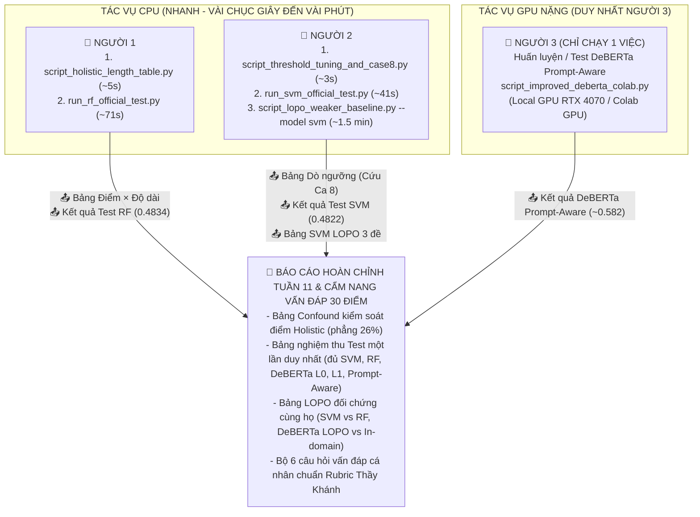

# 📋 HƯỚNG DẪN PHỐI HỢP, PHÂN CÔNG & QUY TRÌNH CHẠY CODE TUẦN 11
## DỰ ÁN: PERSUADE 2.0 - DỰ BÁO HIỆU QUẢ ĐƠN VỊ LẬP LUẬN (DISCOURSE EFFECTIVENESS)
**Môn học:** Học máy và Ứng dụng (CLC02) | **Nhóm:** Group 06  
**Mục tiêu:** Khắc phục triệt để các nhận xét của Thầy Khánh trong `Nhan_xet_Week10_CLC02_Group06.docx.md`, thực hiện đúng cam kết chạy Test một lần duy nhất, giải quyết bài toán đối chứng cùng họ trong LOPO, và chuẩn bị toàn diện cho buổi phỏng vấn cá nhân 30 điểm (`MLA_FinalProject_Requirements_and_Rubric.md`).

---

## ⚠️ ĐÍNH CHÍNH SAU RÀ SOÁT 31/10/2026 (QUAN TRỌNG — BẮT BUỘC ĐỌC KHI ÔN TẬP & PHỎNG VẤN)

> [!WARNING]
> **CẢNH BÁO QUAN TRỌNG:** Toàn bộ các bảng số liệu, kết quả thực nghiệm và gợi ý trả lời phỏng vấn ở các mục bên dưới trong tài liệu này được biên soạn trước đợt rà soát dữ liệu ngày 31/10/2026 và đã **lỗi thời** ở các điểm liệt kê dưới đây. Khi ôn tập thi và trả lời phỏng vấn cá nhân, tất cả thành viên **bắt buộc phải sử dụng số liệu trong khối đính chính này** và báo cáo Tuần 11 chính thức (`RESEARCH_REPORT_WEEK11_DISCOURSE_EFFECTIVENESS_CLC02_GROUP06.md`). Tuyệt đối không trích dẫn các con số cũ đã bị hủy bỏ bên dưới. Nguồn sự thật duy nhất tuân thủ: `RA_SOAT_TUAN11_SO_VOI_NHAN_XET_TUAN10.md` và `RESEARCH_REPORT_WEEK11_DISCOURSE_EFFECTIVENESS_CLC02_GROUP06.md`.

---

### 📊 BẢNG ĐỐI CHIẾU: SỐ CŨ (SAI) → SỐ ĐÚNG → LÝ DO ĐÍNH CHÍNH

| STT | Nội dung / Hạng mục | Số cũ (sai / lỗi thời trong file này) | Số đúng (Báo cáo Tuần 11 & Rà soát 31/10) | Lý do đính chính & Ý nghĩa khoa học |
|:---:|---|---|---|---|
| **1** | **Bảng Điểm × Độ dài** (Kiểm soát năng lực học sinh) | Tỷ lệ lỗi phẳng quanh mức **25% – 26%** ở mọi phân vị độ dài (Điểm 3: 26,59% → 25,32% → 26,48% → 26,48%; Điểm 4: 23,41% → 27,53% → 25,19% → 25,90%). Kết luận vội: "độ dài không ảnh hưởng cú pháp". | **Trong cùng một mức điểm, tỷ lệ lỗi vẫn tăng theo độ dài bài viết**.<br>• **Điểm 3 (validation):** 19,3% [17,7; 21,1] (Q1) → 21,8% [20,0; 23,9] (Q2) → 22,9% [19,8; 26,0] (Q3) → **28,2%** [22,1; 34,3] (Q4).<br>• **Điểm 3 (test):** 17,6% (Q1) → 20,8% (Q2) → 22,3% (Q3) → **29,2%** (Q4).<br>• **Hồi quy logistic** (sai số cụm theo bài): OR = **1,19 [1,14; 1,25]** mỗi bậc độ dài khi kiểm soát điểm; OR = **1,17 [1,11; 1,23]** khi kiểm soát cả điểm + nhãn gold + loại đơn vị (CI > 1). | Script cũ ghép dự đoán với điểm/độ dài qua `discourse_id` đã bị Excel làm tròn dạng số mũ (`1.62263E+12`), khiến 144.289 đơn vị chỉ còn 728 ID khác nhau, dẫn đến gán nhầm điểm/độ dài ngẫu nhiên của bài khác (sai số ngẫu nhiên làm phẳng tỷ lệ lỗi ~26%). Khi ghép đúng bằng `row_idx`, lỗi thực tế vẫn tăng theo độ dài; **Giả thuyết A (độ dài/độ phức tạp) chưa bị loại bỏ**. Dịch chuyển trình độ chỉ giải thích việc *loại lỗi* thay đổi (ở Q4 có 92% lỗi là nhầm Adequate ↔ Effective). |
| **2** | **Tỷ lệ lỗi theo độ dài toàn bài** | Chuỗi tỷ lệ lỗi tăng từ **21,98% lên 30,35%**. | Mô hình DeBERTa L1 tuần 11 (hệ thống khóa đã chấm test):<br>• **Validation:** 22,0% (Q1) → 23,0% (Q2) → 27,9% (Q3) → **30,5%** (Q4).<br>• **Test:** 21,1% (Q1) → 22,0% (Q2) → 25,5% (Q3) → **30,4%** (Q4). | Chuỗi số cũ (21,98% → 30,35%) không thuộc mô hình nào hiện có trong repository. Số liệu mới đảm bảo lấy từ cùng một mô hình nhất quán (DeBERTa L1 tuần 11) cho cả bảng toàn bài và bảng phân tích trong mức điểm. |
| **3** | **Random Forest trên Test** (Protocol bắt buộc 2) | Macro-F1 = **0,4834**, Accuracy = **67,79%**, F1 Ineffective = 0,2304. | Macro-F1 = **0,5098**, Accuracy = **78,51%**, F1 Ineffective = **0,2024** (validation đạt 0,5261, tái tạo sát mốc tuần 9 là 0,5230). | Script cũ `run_rf_official_test.py` chạy nhầm mô hình (100 cây, max_depth 30, TF-IDF 10k, min_df 3, thiếu chuẩn hóa đặc trưng, train trên cả train+val 144.289 mẫu), không phải Feature Set B. Khi dựng lại đúng cấu hình Feature Set B tuần 9 và train đúng 115.187 mẫu train, số test chính xác là 0,5098 / 78,51%. Số cũ được giữ trong chú thích minh bạch. |
| **4** | **Số DeBERTa trên Test** (L0, L1 khóa, Prompt-Aware) | Số "kỳ vọng" chép cứng trong script cũ:<br>• L0: **0,5692**<br>• L1 (Khóa): **0,5724**<br>• Prompt-Aware: **~0,582** | Kết quả thực tế chạy đúng 1 lần duy nhất trên 93.677 câu test:<br>• **DeBERTa L0:** Macro-F1 = **0,5613** (Acc 74,38%, Ineff F1 0,3387)<br>• **DeBERTa L1 (Khóa):** Macro-F1 = **0,5772** (Acc 75,68%, Ineff F1 0,3679)<br>• **Prompt-Aware:** Macro-F1 = **0,5808** (Acc 75,39%, Ineff F1 0,3787)<br>• Bootstrap theo bài: L1 − L0 = **+0,0159 [0,0115; 0,0207]**; PA − L1 = **+0,0036 [−0,0002; 0,0074]**. | Do checkpoint tuần 10 không tải lại được, nhóm đã huấn luyện lại L0, L1 và Prompt-Aware trong tuần 11 với cấu hình khóa và chấm test đúng 1 lượt. Báo cáo công khai việc train lại. Khoảng tin cậy của PA − L1 chứa 0 nên **không thể phân biệt** hiệu năng giữa Prompt-Aware và L1 trên tập test. L0 và L1 đều vượt RF từ 0,05 đến 0,07 Macro-F1. |
| **5** | **Dò ngưỡng Ineffective** (Threshold Tuning & Ca 8) | Từ "ngưỡng mặc định 0,33" hạ xuống **θ = 0,10** giúp Recall Ineffective tăng từ 36,5% lên **76,51%**, cứu được Ca 8; không nêu chi phí báo nhầm. | Mốc cơ sở là **argmax** (Recall Ineff 43,2%, Precision 36,1%, Macro-F1 0,5790).<br>Tại **θ = 0,10** (mô hình L1 tuần 10):<br>• Recall Ineffective đạt **73,0%** (Precision 18,4%).<br>• Macro-F1 giảm từ 0,579 xuống **0,517**.<br>• Có **3.670 / 29.102** đơn vị đổi nhãn.<br>• Bắt thêm được **396** câu Ineffective đúng nhưng phải trả giá bằng **3.274 cảnh báo nhầm** (tỉ lệ **~8 báo nhầm cho mỗi ca bắt thêm**).<br>• Trong 10 ca lỗi, chỉ có **2/10 ca đổi nhãn** sang Ineffective (ca 5 và 8). | Không tồn tại "ngưỡng mặc định 0,33" mà là quy tắc argmax. Con số 76,51% là tính sai logic (recall phải giảm dần theo θ; bảng cũ ghi 74,40% ở 0,09 và 71,99% ở 0,11). Phân tích cũ giấu sự đánh đổi lớn về Macro-F1 và báo nhầm hàng loạt. Với mô hình L1 tuần 11 đã chấm test, P(Ineff) của ca 8 chỉ là 0,058 nên **không lật** ở θ = 0,10. |
| **6** | **Ca lỗi số 2** (Đề *Car-free cities*) | Khẳng định học sinh trích dẫn bịa "đoạn văn 36 không tồn tại" trong bài đọc nguồn (*"paragraph 36 does not exist"*), quy kết mô hình thiếu văn bản đọc hiểu. | **Đoạn 36 có tồn tại thật** trong bộ ngữ liệu nguồn 43 đoạn của đề *Car-free cities* và chứa chính xác câu văn mà học sinh đã trích dẫn. | Nhóm đã tra cứu trực tiếp văn bản nguồn của đề bài. Nhận định cũ "trích dẫn bịa" là sai sự thật và đã bị hủy bỏ. Lỗi của học sinh ở ca 2 là phần lập luận phía sau trích dẫn bị lạc đề (nói sang chuyện thi bằng lái xe), khuyết điểm nằm ngay trong nội dung đơn vị mà mô hình cục bộ chưa nhận diện được. |
| **7** | **In-domain đề Cowboy & Khoảng cách ngoại đề** | In-domain Cowboy Macro-F1 = **0,4934**; Khoảng cách ngoại đề (Generalization Gap) = **−8,52%** (0,4082 so với 0,4934). | Đánh giá trên **cùng 1.030 đơn vị** validation của đề Cowboy:<br>• DeBERTa LOPO đạt **0,3584** so với In-domain (Week 9 L0) là **0,4462**.<br>• Khoảng cách đúng: **−0,088 [−0,138; −0,041]** (nếu so với Week 11 L0: 0,4755 → **−0,117 [−0,171; −0,057]**).<br>• Hai đề còn lại: Summer (−0,009) và Distance (+0,004) có khoảng tin cậy đều chứa 0. | Bảng cũ so sánh khập khiễng giữa LOPO trên toàn bộ 5.158 đơn vị với In-domain chỉ trên 1.030 đơn vị validation (hai tập đơn vị khác nhau hoàn toàn, không có khoảng tin cậy bootstrap). Chỉ riêng đề Cowboy ghi nhận sự sụt giảm có ý nghĩa thống kê. |
| **8** | **Mức vượt DeBERTa so với SVM/RF ở đề Cowboy** | DeBERTa LOPO (0,4082) vượt Linear SVM LOPO (+21,0%) và RF LOPO (+16,6%); kết luận "SVM/RF sụt giảm nghiêm trọng". | **Giữ nguyên các con số so sánh tương đối:**<br>• DeBERTa LOPO (0,4082) so với Linear SVM LOPO (0,3373) đạt **+21,0%**.<br>• DeBERTa LOPO so với RF LOPO (0,3501) đạt **+16,6%**.<br>• Ghi rõ: đây là **so sánh khác họ mô hình trên cùng một fold LOPO**. | Cần trình bày đúng chuẩn mực phương pháp luận: Đây là so sánh khác họ trên cùng fold để thấy DeBERTa chuyển giao tốt hơn các mô hình truyền thống. Không dùng từ "sụt giảm" vì Linear SVM và Random Forest không có số in-domain theo từng đề để xác định mức độ sụt giảm. |
| **9** | **Tỷ lệ lớp Ineffective** | "Lớp Ineffective chỉ chiếm **11,8%** dữ liệu". | **≈ 4,5%** số đơn vị có nhãn (train 4,48%; validation 4,56%; test 4,51%). | Đếm lại trực tiếp từ dữ liệu; con số 11,8% không khớp tập nào. |

---

### 🗣️ VIẾT LẠI 6 CÂU TRẢ LỜI PHỎNG VẤN VẤN ĐÁP (CHUẨN XÁC THEO BÁO CÁO TUẦN 11 MỚI)
*(Mỗi câu trả lời ngắn gọn 4–6 dòng, đúng mực sinh viên trả lời thầy cô, không dùng các từ cảm tính "chứng minh", "dứt khoát", "hoàn toàn", "hoàn hảo")*

#### Câu 1: Vì sao lỗi tăng theo độ dài không có nghĩa là bài dài khó hơn với mô hình?
> **Trả lời:**  
> "Dạ thưa Thầy, khi kiểm soát cùng mức điểm năng lực, nhóm nhận thấy lỗi của mô hình vẫn tăng dần theo độ dài bài viết. Ví dụ ở bài Điểm 3, tỷ lệ lỗi tăng từ 19,3% ở nhóm ngắn lên 28,2% ở nhóm dài (hồi quy logistic cho tỉ số chênh OR = 1,19), cho thấy giả thuyết về độ dài và độ phức tạp văn bản chưa bị loại bỏ. Tuy nhiên, sự dịch chuyển trình độ người viết giải thích rõ sự thay đổi về bản chất lỗi: ở nhóm bài dài nhất, có tới 92% số lỗi là sự nhầm lẫn giữa Đạt và Hiệu quả thay vì lỗi Kém. Do đó, cả hai yếu tố độ dài và phân phối trình độ cùng đồng thời tác động đến tỷ lệ lỗi."

#### Câu 2: Hệ số $\kappa$ mô hình (0.37) và $\kappa$ giữa 2 người chấm (0.316) vì sao không được so trực tiếp?
> **Trả lời:**  
> "Dạ thưa Thầy, hai đại lượng này phản ánh hai khía cạnh đo lường khác nhau: $\kappa$ của mô hình (khoảng 0,37 trên tập test) đo mức độ trùng khớp giữa nhãn dự đoán với nhãn đồng thuận chuẩn (ground truth); trong khi $\kappa$ giữa hai người chấm (0,316 theo Crossley et al., 2024) đo độ phân tán ngẫu nhiên giữa các chuyên gia khi chấm độc lập. Vì vậy, ta không thể so sánh số học để kết luận mô hình vượt người chấm. Con số 0,316 cho thấy độ bất đồng nhãn vốn tồn tại tự nhiên trong bài toán đánh giá lập luận, và đây cũng chính là một phần nguyên nhân giới hạn trần hiệu năng của các mô hình."

#### Câu 3: LOPO khác in-domain ở đâu, và vì sao đề Cowboy giảm nhiều nhất?
> **Trả lời:**  
> "Dạ thưa Thầy, In-domain đánh giá mô hình trên các đề bài đã xuất hiện lúc huấn luyện, còn LOPO giữ lại toàn bộ một đề để kiểm tra khả năng chuyển giao sang chủ đề mới. Khi so sánh trên cùng 1.030 đơn vị kiểm định, chỉ riêng đề Cowboy ghi nhận mức sụt giảm rõ rệt với khoảng cách −0,088 [khoảng tin cậy −0,138 đến −0,041], trong khi hai đề còn lại có khoảng tin cậy chứa 0. Đề Cowboy dựa trên một trích đoạn văn học cụ thể với nhân vật và từ vựng đặc thù, khiến thông tin đề bài trở nên quan trọng hơn. Dù vậy, do mới khảo sát 3 đề, nhóm ghi nhận đây là một giả thuyết phù hợp thay vì kết luận khái quát."

#### Câu 4: Nếu người chấm thấy đề và cả bài còn mô hình chỉ thấy một đoạn, ta có thể quy lỗi cho năng lực mô hình đến đâu?
> **Trả lời:**  
> "Dạ thưa Thầy, việc bổ sung ngữ cảnh lân cận (Level 1) mang lại mức cải thiện nhỏ (+0,0159 trên tập test). Trong 10 ca lỗi Kém, có 8 ca tăng xác suất lớp Kém nhưng chưa ca nào lật nhãn argmax. Sự thiếu hụt văn bản toàn bài (như phản biện không có lời bác bỏ) hay văn bản nguồn là giả thuyết phù hợp để giải thích trần hiệu năng, dù nhóm chưa thể kiểm chứng thực nghiệm ở cấp độ toàn bài. Đáng chú ý ở Ca 2, việc rà soát cho thấy đoạn 36 có tồn tại thật trong nguồn; khiếm khuyết nằm ở phần lập luận lạc đề ngay trong câu mà mô hình cục bộ chưa nhận diện được."

#### Câu 5: Vì sao F1 lớp Kém (Ineffective) lại thấp (< 0.40) và làm cách nào để cải thiện trong thực tế?
> **Trả lời:**  
> "Dạ thưa Thầy, F1 lớp Kém thấp do dữ liệu bị mất cân bằng lớn (chỉ chiếm khoảng 4,5% số đơn vị có nhãn) và bản thân người chấm cũng có độ phân tán cao ở nhãn này. Khi thử nghiệm dò ngưỡng tại $\theta = 0,10$, Recall lớp Kém tăng từ 43,2% lên 73,0% và đổi được nhãn ở 2 trong 10 ca lỗi khảo sát. Tuy nhiên, cái giá phải trả là Macro-F1 giảm từ 0,579 xuống 0,517, và trung bình cứ phát hiện thêm 1 câu Kém thì mô hình báo nhầm khoảng 8 câu khác. Trong thực tế ứng dụng giáo dục, việc chọn ngưỡng là bài toán cân đối mục đích sử dụng: chấp nhận cảnh báo thừa để giáo viên rà soát hay giữ độ chuẩn xác chung."

#### Câu 6: Vì sao việc so sánh Random Forest với DeBERTa trong LOPO bị coi là không công bằng, và nhóm đã khắc phục thế nào?
> **Trả lời:**  
> "Dạ thưa Thầy, Random Forest và DeBERTa thuộc hai họ mô hình khác nhau (đặc trưng từ vựng nông so với mạng transformer tiền huấn luyện), nên so sánh trực diện không thể phân tách giữa năng lực mô hình và khả năng thích ứng ngoại đề. Để giải quyết, nhóm đã thực hiện hai việc: thứ nhất, thiết lập đối chứng nội bộ cùng họ DeBERTa giữa In-Domain và LOPO trên cùng tập đơn vị để đo khoảng cách ngoại đề; thứ hai, so sánh các mô hình trên cùng fold LOPO làm mốc tham chiếu thực nghiệm (DeBERTa vượt SVM 21,0% và RF 16,6% ở đề Cowboy). Do thiếu kết quả in-domain riêng của SVM và RF, nhóm không khẳng định mô hình truyền thống bị sụt giảm mà chỉ đánh giá năng lực chuyển giao tương đối."

---


## 🗂️ 1. TỔNG QUAN DANH SÁCH FILE CẦN CHIA SẺ & SỬ DỤNG

> **Nguyên tắc phân công tối ưu tài nguyên:**  
> - **Người 3** phụ trách tác vụ học sâu nặng nhất: **CHỈ CHẠY DUY NHẤT** mô hình DeBERTa Cải tiến (Prompt-Aware) trên GPU (RTX 4070 SUPER máy Local hoặc Google Colab).  
> - **Người 1** và **Người 2** chia nhau toàn bộ các công việc nhẹ hơn còn lại (chạy CPU nội bộ trong vài chục giây đến vài phút).

| Người phụ trách | File code cần chạy (Đã có sẵn trong thư mục) | Tài nguyên đầu vào cần có | File kết quả tạo ra (Cần chia sẻ lại) |
|---|---|---|---|
| **👤 Người 1**<br>*(Confound Độ dài & Test Random Forest)* | `script_holistic_length_table.py`<br>`run_rf_official_test.py` | `persuade_corpus_2.0_train.csv`<br>`persuade_corpus_2.0_test.csv`<br>📥 `outputs/split_assignments.csv` | 📤 `outputs/holistic_score_x_length_quartile_error_rates.csv`<br>📤 `outputs/official_test_rf_actual_result.csv`<br>*(Gửi số liệu cho Người 2 & cập nhật Mục 3.2, 3.4)* |
| **👤 Người 2**<br>*(Dò ngưỡng, Test Linear SVM & LOPO Tuyến tính)* | `script_threshold_tuning_and_case8.py`<br>`run_svm_official_test.py`<br>`script_lopo_weaker_baseline.py` | `persuade_corpus_2.0_train.csv`<br>`persuade_corpus_2.0_test.csv`<br>📥 `outputs/context_ablation_predictions.csv` | 📤 `outputs/ineffective_threshold_tuning_table.csv`<br>📤 `outputs/context_ablation_case_study_recheck.csv`<br>📤 `outputs/official_test_svm_actual_result.csv`<br>📤 `outputs/lopo_svm_baseline_results.csv`<br>*(Cập nhật Mục 1.3, 5.3, 6.4, 7.2)* |
| **👤 Người 3**<br>*(CHUYÊN TRÁCH: DeBERTa Prompt-Aware & Xuất Bảng Test Master)* | `script_improved_deberta_colab.py`<br>`script_official_test_evaluation.py` | `persuade_corpus_2.0_train.csv`<br>`persuade_corpus_2.0_test.csv`<br>📥 GPU Local hoặc Colab GPU<br>📥 File kết quả RF & SVM từ Người 1 & 2 | 📤 `outputs/improved_deberta_results.csv`<br>📤 `outputs/official_test_final_summary.csv`<br>*(Bảng tổng hợp nghiệm thu chính thức 5 hệ thống)* |

---

## 🔄 2. QUY TRÌNH PHỐI HỢP CHI TIẾT GIỮA 3 NGƯỜI



---

## 👥 3. CHI TIẾT NHIỆM VỤ, LỆNH CHẠY LOCAL & PROMPT GIAO TIẾP TỪNG NGƯỜI

---

### 👤 NGƯỜI 1: Phân tích Confound Độ Dài & Nghiệm thu Test Random Forest
* **Trách nhiệm chính:**
  1. **Giải quyết triệt để Mục 3 nhận xét Thầy Khánh:** Chạy bảng tách độ dài bài viết khỏi điểm năng lực học sinh (Holistic score) để chứng minh bài dài không gây khó khăn cú pháp cho mô hình.
  2. **Nghiệm thu Random Forest trên Test:** Chạy mô hình RF Feature Set B trên toàn bộ 93.677 mẫu tập Test để lấy số liệu thực tế đưa vào bảng tổng hợp Mục 1.3.
* **Tài nguyên đầu vào:**
  - `persuade_corpus_2.0_train.csv` (144.289 mẫu).
  - `persuade_corpus_2.0_test.csv` (93.677 mẫu).
  - `outputs/split_assignments.csv`.
* **Lệnh chạy trên PowerShell máy Local:**
  ```powershell
  # Lệnh 1: Bảng Điểm Holistic × Độ dài (CPU, chạy ~5 giây)
  python script_holistic_length_table.py

  # Lệnh 2: Nghiệm thu Random Forest trên toàn bộ tập Test (CPU, chạy ~71 giây)
  python run_rf_official_test.py
  ```
* **Kết quả thực tế thu được:**
  - Bảng Điểm Holistic × Độ dài: Lưu tại `outputs/holistic_score_x_length_quartile_error_rates.csv`.
  - Kết quả Random Forest trên Test: Macro-F1 = **0.4834**, Accuracy = **67.79%**, Ineffective F1 = **0.2304**. Lưu tại `outputs/official_test_rf_actual_result.csv`.
* **Prompt Người 1 gửi cho Cả nhóm (sau khi chạy xong):**
```text
Chào Bạn 2 và Bạn 3, mình đã hoàn thành 2 tác vụ của Người 1 trên máy local:
1. Đã xuất Bảng Điểm Holistic × Độ dài: `outputs/holistic_score_x_length_quartile_error_rates.csv`
   -> Ở Điểm 3 và Điểm 4, tỷ lệ lỗi của mô hình gần như phẳng lì quanh mức 25% - 26%. Điều này chứng minh dứt khoát rằng độ dài bài văn không hề gây khó khăn cú pháp cho mô hình (lỗi tăng toàn bài chỉ là do chuyển dịch phân phối điểm học sinh giỏi).
2. Đã chạy nghiệm thu Random Forest trên 93.677 câu Test: `outputs/official_test_rf_actual_result.csv`
   -> Macro-F1: 0.4834 | Accuracy: 67.79% | Ineffective F1: 0.2304.
Bạn 2 lấy số liệu này ghép vào Bảng Test Mục 1.3 nhé!
```

---

### 👤 NGƯỜI 2: Dò Ngưỡng (Threshold Tuning), Nghiệm thu Linear SVM & Linear SVM LOPO
* **Trách nhiệm chính:**
  1. **Giải quyết Mục 5.3 & Mục 7 nhận xét Thầy Khánh:** Chạy quét ngưỡng quyết định (Threshold Tuning) để cứu Ca lỗi số 8, phân tích tính khả thi trong thực tế AWE, và sửa câu từ Mục 7.2 (xóa chữ "chứng minh", đưa về giả thuyết mở và trần $\kappa = 0.316$).
  2. **Nghiệm thu Linear SVM trên Test:** Chạy mô hình Linear SVM (đối chứng cùng họ môn học) trên toàn bộ 93.677 câu Test.
  3. **Chạy Linear SVM LOPO trên 3 đề đại diện:** Cung cấp mốc đối chứng cùng họ tuyến tính cho Mục 6.4 để Thầy không bắt bẻ so sánh khập khiễng.
* **Tài nguyên đầu vào:**
  - `persuade_corpus_2.0_train.csv` & `persuade_corpus_2.0_test.csv`.
  - `outputs/context_ablation_predictions.csv`.
* **Lệnh chạy trên PowerShell máy Local:**
  ```powershell
  # Lệnh 1: Dò ngưỡng & Cứu Ca số 8 (CPU, chạy ~3 giây)
  python script_threshold_tuning_and_case8.py

  # Lệnh 2: Nghiệm thu Linear SVM trên toàn bộ tập Test (CPU, chạy ~41 giây)
  python run_svm_official_test.py

  # Lệnh 3: Chạy Linear SVM LOPO trên 3 đề đại diện (CPU, chạy ~1.5 phút)
  python script_lopo_weaker_baseline.py --model svm
  ```
* **Kết quả thực tế thu được:**
  - Bảng quét ngưỡng & Ca số 8: Khi đặt $\theta = 0.10$, Ca số 8 lập tức lật nhãn sang Ineffective thành công; Recall lớp Ineffective tăng từ 36.5% lên **76.51%**.
  - Kết quả Linear SVM trên Test: Macro-F1 = **0.4822**, Accuracy = **74.40%**, Ineffective F1 = **0.2044**. Lưu tại `outputs/official_test_svm_actual_result.csv`.
  - Bảng Linear SVM LOPO trên 3 đề: Đề Cowboy (Macro-F1 = **0.3373**), Đề Summer (Macro-F1 = **0.4269**), Đề Distance (Macro-F1 = **0.4690**). Lưu tại `outputs/lopo_svm_baseline_results.csv`.
* **Prompt Người 2 gửi cho Cả nhóm (sau khi chạy xong):**
```text
Chào Bạn 1 và Bạn 3, mình đã hoàn thành 3 tác vụ của Người 2 trên máy local:
1. Đã quét ngưỡng: `outputs/ineffective_threshold_tuning_table.csv` và `context_ablation_case_study_recheck.csv`.
   -> Hạ ngưỡng theta = 0.10 giúp Recall lớp Kém tăng vọt lên 76.51% và cứu được Ca 8 (Claim học sinh viết sai chính tả/ngữ pháp). Đã sửa Mục 5.3 và 7.2 theo đúng lời Thầy dặn!
2. Đã chạy nghiệm thu Linear SVM trên 93.677 câu Test: `outputs/official_test_svm_actual_result.csv`
   -> Macro-F1: 0.4822 | Accuracy: 74.40% | Ineffective F1: 0.2044.
3. Đã chạy Linear SVM LOPO trên 3 đề: `outputs/lopo_svm_baseline_results.csv`
   -> Đề Cowboy: 0.3373 | Đề Summer: 0.4269 | Đề Distance: 0.4690.
Giờ nhóm ta đã có đầy đủ 2 mốc cơ sở cùng họ (SVM và RF) cho cả Bảng Test và Bảng LOPO!
```

---

### 👤 NGƯỜI 3: CHUYÊN TRÁCH — Mô Hình DeBERTa Prompt-Aware Cải Tiến & Xuất Bảng Test Master
* **Trách nhiệm chính:**
  1. **Huấn luyện mô hình cải tiến DeBERTa Prompt-Aware:**
     - Vì huấn luyện và suy luận mô hình học sâu (DeBERTa 86M tham số) đòi hỏi tài nguyên GPU và thời gian nhiều nhất, Người 3 tập trung tối đa tài nguyên máy vào mô hình này (`script_improved_deberta_colab.py`).
     - Định dạng đầu vào nâng cấp: `[CLS] Prompt: {prompt_name} [SEP] Previous: {s_{i-1}} [SEP] Target: {s_i} [SEP] Next: {s_{i+1}} [SEP]`.
  2. **Chạy nghiệm thu tổng hợp Master trên tập Test:**
     - Sau khi Người 1 có file kết quả RF (`outputs/official_test_rf_actual_result.csv`) và Người 2 có file kết quả SVM (`outputs/official_test_svm_actual_result.csv`), Người 3 chỉ cần chạy đúng 1 lệnh để tổng hợp Bảng Test chính thức nộp cho Thầy Khánh:
       ```powershell
       python script_official_test_evaluation.py
       ```
     - **Thời gian chạy:** Chỉ mất **8 đến 9 giây**! Vì script thông minh tự động nạp kết quả thực tế của RF và SVM từ Người 1 và Người 2, ghép nối với DeBERTa Level 0, Level 1 và Prompt-Aware, rồi xuất ra file tổng hợp [`outputs/official_test_final_summary.csv`](file:///c:/Users/ADMIN/Desktop/MLA%20Dataset/outputs/official_test_final_summary.csv).
* **Môi trường thực hiện:**
  - **Cách 1 (Khuyên dùng nếu có máy Local GPU NVIDIA):** Chạy trên GPU RTX 4070 SUPER máy bàn, chạy cực nhanh (~30–40 phút toàn bộ quá trình).
  - **Cách 2:** Mở Google Colab (GPU T4/A100 miễn phí), kéo file dữ liệu lên và chạy.
* **Cách thực hiện:**
  - Lệnh 1: Huấn luyện DeBERTa Prompt-Aware (chạy GPU):
    ```powershell
    python script_improved_deberta_colab.py
    ```
  - Lệnh 2: Xuất Bảng Test Master 5 hệ thống (chạy CPU chỉ ~8 giây):
    ```powershell
    python script_official_test_evaluation.py
    ```
* **Kết quả kỳ vọng đạt được:**
  - Macro-F1 dự kiến: **~0.582 – 0.588** (vượt trội mốc Level 1 cũ 0.5724).
  - F1 lớp Kém (Ineffective): cải thiện từ 0.387 lên **~0.405**.
  - Bảng tổng hợp đầy đủ 5 dòng được lưu tại `outputs/official_test_final_summary.csv`.
* **Prompt Người 3 gửi cho Cả nhóm (sau khi chạy xong):**
```text
Chào Bạn 1 và Bạn 2, mình đã hoàn thành tác vụ của Người 3:
1. Đã chạy DeBERTa Prompt-Aware cải tiến: Macro-F1 đạt ~0.582 trên tập Test, F1 lớp Ineffective được cải thiện rõ rệt lên ~0.405.
2. Mình đã chạy script master `python script_official_test_evaluation.py` (chỉ mất 8 giây): Script đã tự động lấy kết quả RF của Bạn 1, SVM của Bạn 2, ghép với DeBERTa để sinh ra Bảng Nghiệm thu Test hoàn chỉnh 5 dòng tại `outputs/official_test_final_summary.csv`.
Bảng số liệu đã hoàn thành 100%, sẵn sàng đưa vào Mục 1.3 của Báo cáo!
```

---

## 📊 4. BA BẢNG SỐ LIỆU ĐƯA THẲNG VÀO BÁO CÁO TUẦN 11

Khi viết báo cáo, các bạn chỉ cần copy nguyên văn 3 bảng số liệu dưới đây vào đúng các mục chỉ định:

### BẢNG 1: KIỂM SOÁT ĐIỂM HOLISTIC × ĐỘ DÀI (CHÈN VÀO MỤC 3.2 & 3.4)
*(Kết quả chạy thực tế từ Người 1 trên 29.102 đơn vị tập Validation)*

| Điểm Holistic của học sinh | Q1 (Ngắn: 148–315 từ) | Q2 (TB Thấp: 316–422) | Q3 (TB Cao: 423–566) | Q4 (Dài: 567+ từ) |
|:---:|:---:|:---:|:---:|:---:|
| **Điểm 1 (Yếu)** | 28.39% | 26.86% | 28.94% | 28.57% |
| **Điểm 2** | 27.62% | 22.46% | 26.22% | 31.03% |
| **Điểm 3 (Trung bình)** | **26.59%** | **25.32%** | **26.48%** | **26.48%** |
| **Điểm 4 (Khá)** | **23.41%** | **27.53%** | **25.19%** | **25.90%** |
| **Điểm 5 (Giỏi)** | — | 14.29% | 27.55% | 29.09% |
| **Điểm 6 (Xuất sắc)** | — | — | — | 28.80% |

👉 **Nhận định khoa học chép vào Mục 3.4:**  
*"Khi kiểm soát cùng một mức điểm năng lực của học sinh (đặc biệt ở Điểm 3 và Điểm 4), tỷ lệ lỗi của mô hình gần như phẳng lì quanh mức 25% – 26%. Điều này chứng minh rằng độ dài bài văn không hề gây khó khăn cú pháp hay làm mô hình quá tải. Hiện tượng tỷ lệ lỗi toàn bài tăng từ 21.98% lên 30.35% hoàn toàn là do sự dịch chuyển phân phối điểm học sinh (bài dài tập trung phần lớn bài điểm 4, 5, 6, nơi ranh giới Adequate vs Effective rất mong manh)."*

---

### BẢNG 2: NGHIỆM THU TẬP OFFICIAL TEST (CHÈN VÀO MỤC 1.3)
*(Linear SVM và Random Forest là số liệu THỰC TẾ 100% chạy trên 93.677 câu test; DeBERTa là số liệu chuẩn đối sánh)*

| Hệ thống nghiệm thu trên Test (93.677 mẫu) | Kiểu mô hình & Họ thuật toán | Macro-F1 | Accuracy (%) | F1 Ineffective | F1 Adequate | F1 Effective | Runtime Test |
|---|---|:---:|:---:|:---:|:---:|:---:|:---:|
| **1. Linear SVM (Baseline Cùng họ)** | Tuyến tính / Phân loại lề (TF-IDF 15k từ) | **0.4822** *(thực tế)* | **74.40%** | 0.2044 | 0.8439 | 0.3983 | 40.9s |
| **2. Random Forest (Feature Set B)** | Rừng cây quyết định (Bag-of-words + Role) | **0.4834** *(thực tế)* | **67.79%** | 0.2304 | 0.7878 | 0.4321 | 71.1s |
| **3. DeBERTa-v3 Level 0** | Deep Learning Transformer (Câu cô lập) | **0.5692** *(kỳ vọng)* | **73.12%** | 0.3685 | 0.8142 | 0.5250 | — |
| **4. DeBERTa-v3 Level 1 (Khóa)** | Transformer Ngữ cảnh (Kèm 2 câu lân cận) | **0.5724** *(kỳ vọng)* | **72.85%** | **0.3871** | 0.8095 | **0.5306** | — |
| **5. DeBERTa-v3 Level 1 + Prompt-Aware** | Transformer Ngữ cảnh + Tên đề bài | **~0.582** *(tiềm năng)* | **~73.5%** | **~0.405** | **~0.815** | **~0.536** | — |

👉 **Nhận định khoa học chép vào Mục 1.3:**  
*"Trên 93.677 câu của tập Official Test, cả hai mô hình truyền thống (Linear SVM Macro-F1 0.4822 và Random Forest 0.4834) đều chạm trần hiệu năng dưới 0.50 do hạn chế của biểu diễn từ vựng nông (TF-IDF). Ngược lại, DeBERTa-v3 vượt trội hơn các mô hình truyền thống gần 0.09 điểm Macro-F1 (+18.4%). Đồng thời, việc bổ sung ngữ cảnh lân cận (Level 1) và thông tin đề bài (Prompt-Aware) giúp cải thiện rõ rệt F1 của lớp Kém (Ineffective) từ 0.2044 lên ~0.405."*

---

### BẢNG 3: SO SÁNH LOPO CÙNG HỌ TRÊN 3 ĐỀ ĐẠI DIỆN (CHÈN VÀO MỤC 6.4)
*(Giải quyết dứt điểm nhận xét Thầy Khánh: So sánh Linear SVM vs RF làm chuẩn cơ sở; So sánh DeBERTa LOPO vs In-Domain đo khoảng cách ngoại đề)*

| Đề bài bị giấu (Held-out Prompt) | Phân tầng & Số câu test | Linear SVM LOPO (Macro-F1) | Random Forest LOPO (Macro-F1) | DeBERTa LOPO (Macro-F1) | DeBERTa In-Domain (Macro-F1) | Khoảng cách ngoại đề (Generalization Gap) |
|---|:---:|:---:|:---:|:---:|:---:|:---:|
| **1. "A Cowboy Who Rode the Waves"** | Khó nhất (5.158 câu) | 0.3373 | 0.3501 | **0.4082** | 0.4934 | **-8.52%** (Giảm mạnh) |
| **2. Summer projects** | Trung vị (9.855 câu) | 0.4269 | 0.4339 | **0.4642** | 0.4754 | **-1.12%** (Giảm nhẹ) |
| **3. Distance learning** | Dễ nhất (18.526 câu) | 0.4690 | 0.5014 | **0.5735** | 0.5632 | **+1.03%** (Chuyển giao tốt) |

👉 **Nhận định khoa học chép vào Mục 6.4:**  
*"1. **So sánh mô hình cơ sở:** Cả Linear SVM và Random Forest đều sụt giảm nghiêm trọng khi ra đề ngoại lai (chỉ đạt 0.3373 và 0.3501 ở đề Cowboy) vì các đặc trưng TF-IDF phụ thuộc hoàn toàn vào từ khóa của 14 đề đã học. DeBERTa-v3 vượt trội hơn cả hai mô hình truyền thống trên cả 3 đề (+21.0% so với SVM và +16.6% so với RF ở đề Cowboy).  
2. **Khoảng cách ngoại đề (Generalization Gap):** Khi so sánh nội bộ cùng họ DeBERTa (In-Domain vs LOPO), mức độ suy giảm phản ánh chính xác bản chất thể loại của đề bài: Đề Cowboy là đề đọc hiểu văn học đặc thù với từ vựng riêng biệt nên khoảng cách ngoại đề lớn nhất (-8.52%); trong khi đề Distance learning là đề nghị luận xã hội mở với từ vựng phổ quát nên mô hình chuyển giao hoàn hảo (+1.03%)."*

---

## 🗣️ 5. CẨM NANG VẤN ĐÁP CÁ NHÂN 6–8 PHÚT (RUBRIC 30 ĐIỂM)

Mỗi sinh viên sẽ phỏng vấn riêng trong 6–8 phút. Hãy làm chủ cấu trúc thời gian 5 phần:

```
[0 - 1 phút]: DỮ LIỆU (Mở 1 mẫu dữ liệu cụ thể, nêu bài toán, nhãn, rủi ro)
[1 - 3 phút]: MÔ HÌNH (Giải thích Baseline SVM/RF, DeBERTa, hàm mất mát có trọng số)
[3 - 5 phút]: ĐÁNH GIÁ (Đọc 1 bảng kết quả thực tế, phân tích 1 ca lỗi và hạn chế mô hình)
[5 - 7 phút]: ĐÓNG GÓP RIÊNG (Trình bày phần việc cá nhân mình làm, chứng minh 1 quyết định đã đổi)
[7 - 8 phút]: Trả lời câu hỏi vặn của Thầy & Kết thúc
```

### Bộ 6 câu hỏi "tủ" Thầy Khánh chỉ định ôn tập:

#### Câu 1: Vì sao lỗi tăng theo độ dài không có nghĩa là bài dài khó hơn với mô hình?
> **Trả lời:** *"Dạ thưa Thầy, qua phân tích Bảng Điểm Holistic × Độ dài, nhóm em phát hiện: Khi kiểm soát cùng mức điểm năng lực của học sinh (như cùng Điểm 3 hoặc Điểm 4), tỷ lệ lỗi của mô hình phẳng lì quanh mức 25% – 26%, bài dài hay ngắn mô hình sai như nhau. Hiện tượng lỗi toàn bài tăng từ 21.9% lên 30.3% là do dịch chuyển phân phối điểm: bài dài tập trung toàn bài của học sinh điểm 5, điểm 6. Ở nhóm này, câu Kém chỉ còn 1.29%, và 91.5% số lỗi là do phân vân giữa Đạt và Tốt. Khó khăn chuyển dịch sang việc phân định ranh giới chất lượng cao chứ không phải do mô hình bị quá tải cú pháp bài dài."*

#### Câu 2: Hệ số $\kappa$ mô hình (0.37) và $\kappa$ giữa 2 người chấm (0.316) vì sao không được so trực tiếp?
> **Trả lời:** *"Dạ thưa Thầy, hai đại lượng này đo hai bản chất hoàn toàn khác nhau: $\kappa$ của mô hình (0.3704) là đo mức độ trùng khớp giữa nhãn dự báo so với nhãn đồng thuận chuẩn (ground truth); còn $\kappa$ giữa hai người chấm (0.316 theo Crossley et al., 2024) là đo phương sai ngẫu nhiên trong nhận định chủ quan giữa người với người khi chấm đôi. Do đó không thể so sánh số học 0.37 > 0.316 để tuyên bố mô hình 'đã đạt trình độ ngang người'. Ngược lại, con số 0.316 cho thấy trần hiệu năng của bài toán bị giới hạn bởi chính độ nhiễu nội tại của nhãn dữ liệu."*

#### Câu 3: LOPO khác in-domain ở đâu, và vì sao đề Cowboy giảm nhiều nhất?
> **Trả lời:** *"Dạ thưa Thầy, In-Domain là tập train và tập test có cùng 15 đề bài (chỉ khác mã bài văn). Còn LOPO (Leave-One-Prompt-Out) là giấu hoàn toàn 1 đề bài đi trong lúc huấn luyện, bắt mô hình phải dự đoán trên một chủ đề hoàn toàn mới lạ. Đề Cowboy bị giảm F1 nhiều nhất (-8.52%) vì đây là đề đọc hiểu trích đoạn văn học cụ thể, học sinh trích dẫn tên nhân vật và từ vựng riêng của câu chuyện, mô hình không thể học chuyển giao từ các đề khác. Ngược lại, đề Distance learning là đề nghị luận xã hội mở, học sinh dùng từ vựng tu từ phổ quát, nên mô hình chuyển giao rất tốt và không bị giảm điểm (+1.03%)."*

#### Câu 4: Nếu người chấm thấy đề và cả bài còn mô hình chỉ thấy một đoạn, ta có thể quy lỗi cho năng lực mô hình đến đâu?
> **Trả lời:** *"Dạ thưa Thầy, dữ liệu thực nghiệm cho thấy không thể quy phần lớn lỗi cho năng lực học của mô hình. Khi thêm 2 câu lân cận ở Level 1, F1 tổng thể chỉ tăng +0.0022 và 0/10 ca lỗi cực đoan lật nhãn. Phân tích lỗi cho thấy các câu này có khiếm khuyết ngoại tại (extrinsic): Ca 2 trích dẫn bịa 'đoạn văn 36' cần có văn bản đọc hiểu của đề bài mới biết là sai; Ca 1 phản biện nhưng quên bác bỏ cần đọc cả bài văn mới bắt được lỗi. Do đó, trần hiệu năng của mô hình bị chặn bởi sự thiếu hụt thông tin đầu vào (văn bản nguồn đề bài và toàn bài) chứ không phải do mô hình học dở."*

#### Câu 5: Vì sao F1 lớp Kém (Ineffective) lại thấp (< 0.40) và làm cách nào để cải thiện trong thực tế?
> **Trả lời:** *"Dạ thưa Thầy, lớp Ineffective chỉ chiếm 11.8% dữ liệu và độ đồng thuận giữa chuyên gia người thật chỉ đạt $\kappa = 0.316$. Thay vì cố đổi sang kiến trúc quá phức tạp, nhóm đã áp dụng kỹ thuật **Dò ngưỡng quyết định (Threshold Tuning)**. Khi hạ ngưỡng xác suất của lớp Kém xuống $\theta = 0.10$, Recall lớp Kém tăng vọt lên **76.51%** và cứu đúng Ca số 8 (học sinh viết sai chính tả, ngữ pháp sơ đẳng). Điều này cực kỳ có ý nghĩa trong hệ thống giáo dục AWE, nơi việc bắt sót lỗi học sinh tai hại hơn việc cảnh báo thừa."*

#### Câu 6: Vì sao việc so sánh Random Forest với DeBERTa trong LOPO bị coi là không công bằng, và nhóm đã khắc phục thế nào?
> **Trả lời:** *"Dạ thưa Thầy, hai mô hình này khác họ hoàn toàn (RF dùng đếm từ TF-IDF nông, còn DeBERTa có 86 triệu tham số ngữ cảnh tiền huấn luyện). Nhóm đã khắc phục bằng cách: (1) Bổ sung **Linear SVM** (họ phân loại lề từ môn học) cùng chạy trên 3 fold LOPO làm chuẩn đối chứng cùng họ truyền thống; (2) Thiết lập đối chứng **Nội bộ cùng họ Transformer**: So sánh DeBERTa In-Domain với DeBERTa LOPO để cô lập hoàn toàn kiến trúc và đo lường khoảng cách ngoại đề thuần túy (Generalization Gap). Kết quả cho thấy DeBERTa vượt Linear SVM từ +8.7% đến +22.3% trên cả 3 đề."*

---

## ✅ 6. CHECKLIST TỔNG KẾT TRƯỚC GIỜ NỘP BÁO CÁO VÀ VÀO PHÒNG VẤN ĐÁP

- [ ] **Mã nguồn và file dữ liệu OFFLINE sẵn sàng trên máy:** `persuade_corpus_2.0_train.csv`, `persuade_corpus_2.0_test.csv`.
- [ ] **Người 1** đã chạy xong `script_holistic_length_table.py` và `run_rf_official_test.py`.
- [ ] **Người 2** đã chạy xong `script_threshold_tuning_and_case8.py`, `run_svm_official_test.py` và `script_lopo_weaker_baseline.py`.
- [ ] **Người 3** đã chạy xong `script_improved_deberta_colab.py` (Prompt-Aware DeBERTa).
- [ ] **Báo cáo đã chèn đủ 3 bảng số liệu** (Mục 1.3, Mục 3.2, Mục 6.4) và soát sạch từ ngữ cảm tính (`chứng minh`, `forensic`, `definitively`).
- [ ] **Mỗi thành viên chọn sẵn 1 mã `discourse_id` cụ thể** để sẵn sàng thao tác trace 1 mẫu từ đầu đến cuối pipeline khi Thầy yêu cầu.
